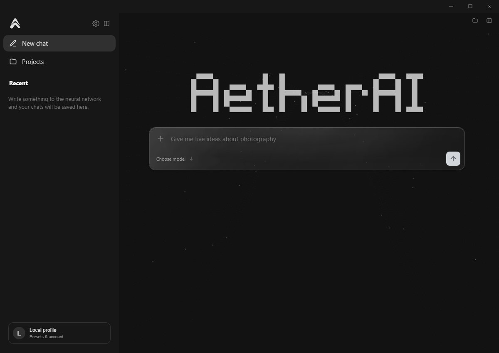

<p align="center">
  <picture>
    <source media="(prefers-color-scheme: dark)" srcset="resources/branding/pixel-wordmark-dark.svg">
    
  </picture>
</p>
<p align="center">Your models. Your workspace. Your choice.</p>
<p align="center">
  <a href="https://github.com/Kuloka/AetherAI/releases/latest"></a>
  <a href="https://github.com/Kuloka/AetherAI/actions/workflows/desktop.yml"></a>
  <a href="https://github.com/Kuloka/AetherAI/stargazers"></a>
  <a href="#download"></a>
</p>
<p align="center">
  <a href="https://aetherai-chat.pages.dev/">Website</a> &nbsp; / &nbsp;
  <a href="https://github.com/Kuloka/AetherAI/releases/latest">Download</a> &nbsp; / &nbsp;
  <a href="docs/application-guide.md">Documentation</a> &nbsp; / &nbsp;
  <a href="#development">Development</a>
</p>

<p align="center"></p>

AetherAI is a desktop AI workspace for local models and cloud providers. Chat, work with code and files, and choose the model that fits the task. You control which provider receives your requests.

## What you can do

- **Use your own models and keys.** Connect OpenRouter, Groq, Gemini, Cerebras, SambaNova or Ollama Cloud; run downloaded models locally with Ollama or the Windows starter engine.
- **Keep the workspace simple.** Select models and thinking levels in one compact menu. Choose entire model families in Preferences.
- **Work with real files.** Attach context, copy code, and create project files when your request explicitly asks for them.
- **See what is happening.** Follow request states, token counts and provider-reported limits. Counts that are estimates are marked as estimates.

Cloud availability, prices and limits depend on your provider account. AetherAI does not turn another model into Claude or promise unlimited free access. Visual presets change appearance, not the model behind your answer.

## Download

Get the installers from [GitHub Releases](https://github.com/Kuloka/AetherAI/releases/latest).

- **Windows x64:** installer or portable executable. Quick setup can download a compact CPU runtime and starter model without Ollama.
- **macOS:** Apple Silicon and Intel DMGs. For local inference, use Ollama.
- **Linux x64:** AppImage or Debian/Ubuntu package. For local inference, use Ollama.

macOS builds are unsigned and not notarized. Model downloads need internet access; local inference runs on your computer after setup. Larger models require more RAM and disk space. See [installation and hardware guidance](docs/application-guide.md).

## Control and privacy

Provider keys use OS-backed encrypted storage. Cloud requests send messages, attachments and selected context to the provider you choose. Disabling a provider removes it from new requests without deleting its key. Local inference keeps model execution on your device; optional online services can still make network requests.

Visual styles and response preferences remain separate from model selection. See [appearance](docs/chat-appearance.md), [conversation memory](docs/conversation-memory.md), and [notifications and updates](docs/app-updates.md).

## Development

```sh
npm install
npm start
npm run check
npm test
```

On Windows PowerShell, use `npm.cmd` if script execution blocks `npm.ps1`.

Build packages with `npm run dist:win`, `npm run dist:mac` or `npm run dist:linux` on the corresponding platform. End users do not need Node.js or development dependencies.

[Detailed application guide](docs/application-guide.md) / [Artifact workflow](docs/artifact-workflow.md) / [Website sources](docs/source/README.md)
